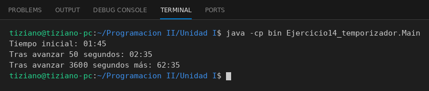

# Temporizador

Programación II - Unidad 1 - Ejercicio 14

## Consigna
Modelar un temporizador digital con minutos y segundos, y hacer transcurrir el tiempo manteniendo consistente la relación entre ambos.

## Lógica
- **Atributos (privados):** `minutos` y `segundos` (int).
- **Constructor:** valida que los minutos no sean negativos y que los segundos estén entre 0 y 59.
- **`avanzarSegundos(cantidad)`:** pasa todo a segundos totales (`minutos * 60 + segundos + cantidad`) y lo vuelve a separar: `minutos = total / 60` (división entera) y `segundos = total % 60` (resto). Así los segundos nunca superan 59 y el excedente se acumula en minutos. Rechaza cantidades negativas.
- **`mostrarTiempo()`:** devuelve el tiempo con formato `MM:SS`.
- **`Main`:** parte de 01:45, avanza 50 segundos (02:35) y luego 3600 más (62:35).

## Ejecución

